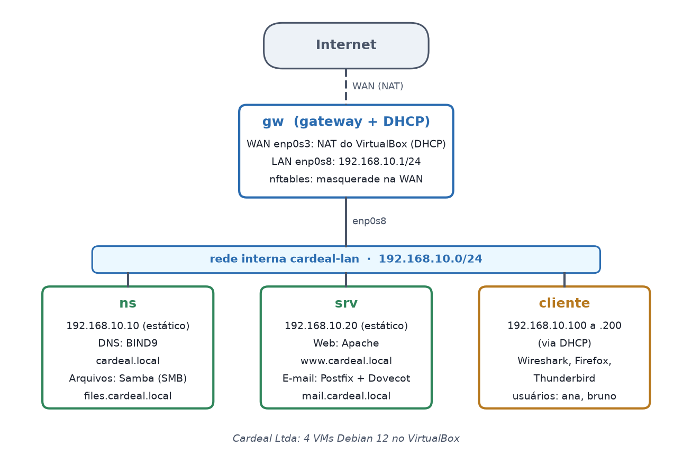
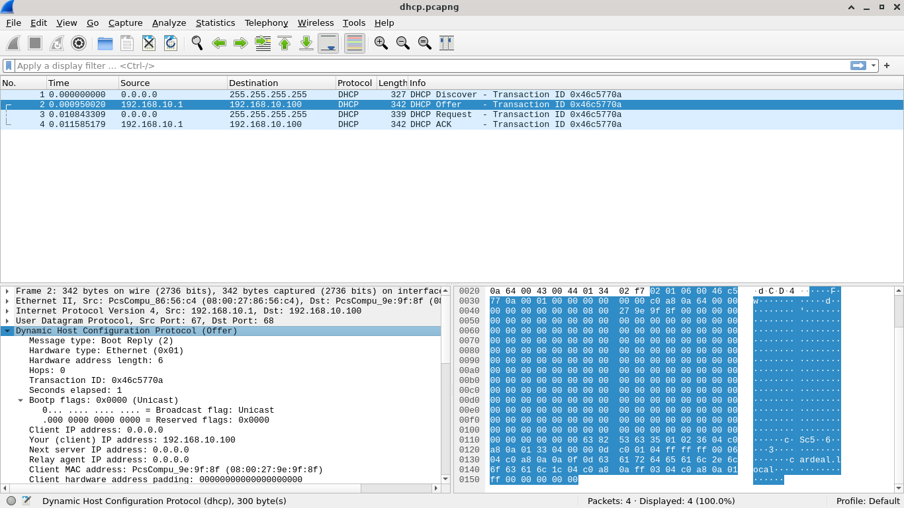
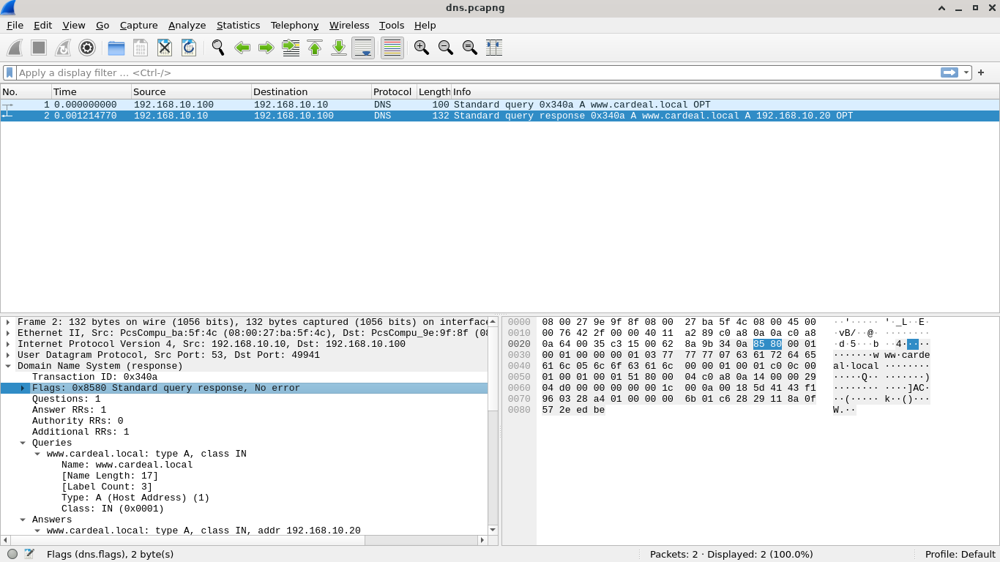
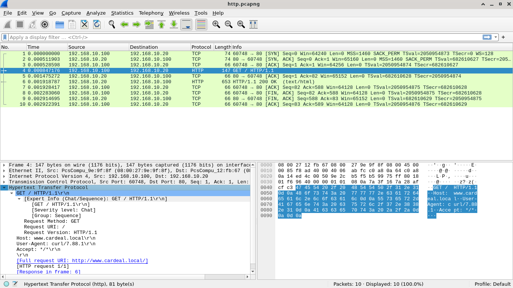
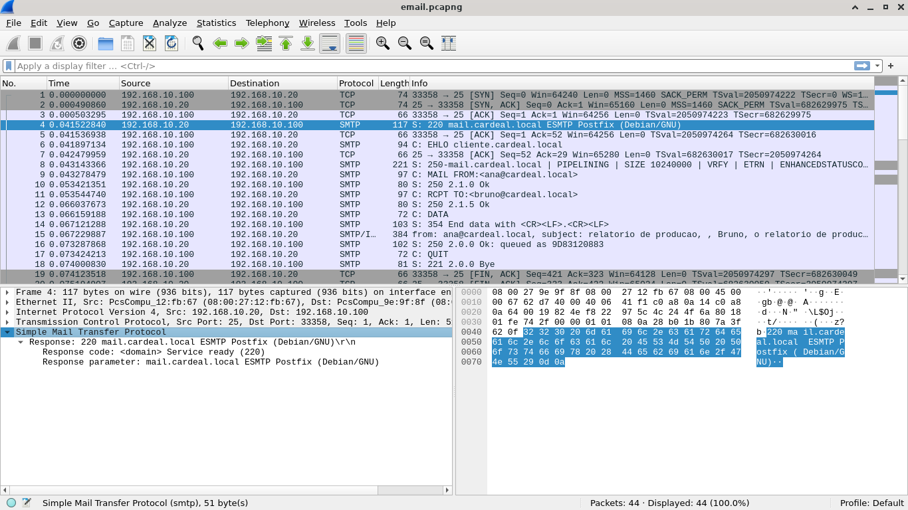

# Infraestrutura de Rede da Cardeal Ltda: Relatório Final

Caio Garcez Ribeiro
Redes de Computadores, UFPel, 2026/2

## Resumo

Este relatório documenta a rede interna da Cardeal Ltda, uma empresa fictícia,
montada em quatro máquinas virtuais Debian 12 no VirtualBox. A rede
192.168.10.0/24 oferece DNS, página Web, e-mail interno, compartilhamento de
arquivos por SMB, endereçamento automático por DHCP e acesso à internet por
um gateway com NAT. Todos os serviços foram testados a partir de uma máquina
cliente, e as quatro capturas pedidas (DHCP, DNS, HTTP e e-mail) estão na
pasta `wireshark/` do repositório, com a análise de cada uma na seção 6.

O planejamento da Entrega 1 se manteve quase inteiro. As mudanças foram o
aumento da memória do gateway de 512 MB para 1 GB e a ordem de execução de
dois scripts de configuração, e as duas estão explicadas na seção 8.

## 1. Infraestrutura e topologia

A rede tem um gateway, dois servidores e um cliente. O gateway (gw) é a
única máquina com uma placa ligada ao NAT do VirtualBox, que faz o papel da
WAN, e a segunda placa dele fica na rede interna `cardeal-lan`. As outras
três VMs têm uma placa só, na rede interna, e saem para a internet passando
pelo gw.



A divisão dos serviços segue a função de cada um. O gw concentra a borda da
rede e o DHCP, porque é ele que liga a LAN ao mundo e é o gateway padrão que
o DHCP anuncia. A ns cuida dos nomes e dos arquivos (BIND9 e Samba), serviços
de infraestrutura que as outras máquinas consultam. A srv hospeda as
aplicações que o funcionário usa diretamente, a página Web (Apache) e o
e-mail (Postfix e Dovecot). O cliente, com interface gráfica XFCE, existe para
os testes e as capturas, no lugar de um computador de funcionário.

| Nome                | IP            | Serviço                            |
| ------------------- | ------------- | ---------------------------------- |
| gw.cardeal.local    | 192.168.10.1  | gateway e DHCP                     |
| ns.cardeal.local    | 192.168.10.10 | DNS                                |
| files.cardeal.local | 192.168.10.10 | Samba (compartilhamento `publico`) |
| srv.cardeal.local   | 192.168.10.20 | nome da máquina                    |
| www.cardeal.local   | 192.168.10.20 | página da empresa                  |
| mail.cardeal.local  | 192.168.10.20 | SMTP, IMAP e POP3 (MX 10)          |

## 2. Configuração das máquinas virtuais

As quatro VMs usam o Debian 12.15 (netinst) com 1 CPU cada. A memória e o
disco ficaram assim:

| VM      | RAM     | Disco | Placas de rede                                     | Interface gráfica |
| ------- | ------- | ----- | -------------------------------------------------- | ----------------- |
| gw      | 1024 MB | 8 GB  | enp0s3 em NAT (WAN), enp0s8 na `cardeal-lan` (LAN) | não               |
| ns      | 1024 MB | 10 GB | enp0s3 na `cardeal-lan`                            | não               |
| srv     | 1024 MB | 10 GB | enp0s3 na `cardeal-lan`                            | não               |
| cliente | 2048 MB | 20 GB | enp0s3 na `cardeal-lan`                            | XFCE              |

O total é de 5 GB de RAM e 48 GB de disco, uma fração pequena dos 32 GB de
memória do computador usado, e as quatro VMs ficam ligadas ao mesmo tempo
sem problema.

A criação das VMs e a instalação do sistema são automáticas. O script
`vms/criar-vms.ps1` cria as máquinas com o VBoxManage, e o
`vms/instalar-debian.ps1` instala o Debian usando as respostas do arquivo
`vms/preseed.cfg`, que define o hostname, o domínio `cardeal.local`, o
usuário `caio` e a lista de pacotes. Com isso, a instalação das quatro
máquinas não exige nenhuma interação, e o ambiente pode ser recriado do zero
por qualquer pessoa que clone o repositório.

Cada serviço tem uma pasta com os arquivos de configuração e um script
`setup-*.sh` que instala os pacotes e copia os arquivos para o lugar certo.
Os scripts rodam enquanto a placa da VM ainda está em NAT, para que o `apt`
consiga baixar os pacotes. Depois, o `vms/ligar-na-lan.ps1` passa a placa da
ns, da srv e do cliente para a rede interna. Para administrar as VMs sem
abrir a janela de cada uma, o gw tem um redirecionamento de porta do
VirtualBox (127.0.0.1:2201 para a porta 22), e as outras máquinas são
acessadas por SSH a partir dele.

O papel de cada configuração:

- **gw:** `gateway/interfaces` deixa a WAN em DHCP do VirtualBox e fixa a LAN
  em 192.168.10.1/24; `99-roteamento.conf` liga o `net.ipv4.ip_forward`; o
  `nftables.conf` tem uma única regra de `masquerade` na saída pela enp0s3.
  O `dhcp/dhcpd.conf` (ISC DHCP) atende só a enp0s8.
- **ns:** o BIND9 é autoritativo para a zona direta `cardeal.local` e para a
  reversa `10.168.192.in-addr.arpa`, aceita consultas e recursão só da LAN e
  encaminha nomes externos para 8.8.8.8 e 1.1.1.1. O Samba compartilha
  `/srv/samba/publico` com leitura e escrita para o grupo `funcionarios`.
- **srv:** o Apache serve o site `cardeal.conf` com o `ServerName
www.cardeal.local`. O Postfix aceita mensagens para `@cardeal.local` e
  entrega em `~/Maildir`, de onde o Dovecot as lê por IMAP e POP3. As contas
  de teste são `ana` e `bruno`.
- **cliente:** recebe o IP por DHCP e tem Wireshark, Thunderbird, Firefox,
  `smbclient`, `dig`, `curl` e `swaks`.

## 3. Endereçamento IP

| Faixa ou endereço               | Uso                                      |
| ------------------------------- | ---------------------------------------- |
| 192.168.10.0/24                 | rede interna, máscara 255.255.255.0      |
| 192.168.10.1                    | gateway padrão (gw)                      |
| 192.168.10.2 a 192.168.10.99    | reservada para servidores com IP fixo    |
| 192.168.10.10                   | ns (DNS e Samba), estático               |
| 192.168.10.20                   | srv (Web e e-mail), estático             |
| 192.168.10.100 a 192.168.10.200 | faixa dinâmica do DHCP                   |
| 192.168.10.255                  | broadcast                                |
| 10.0.2.15/24                    | WAN do gw, recebida do NAT do VirtualBox |

O DHCP entrega, junto com o endereço, a máscara 255.255.255.0, o gateway
192.168.10.1, o DNS 192.168.10.10, o domínio `cardeal.local` e um lease de
uma hora (máximo de duas). Os servidores ficam fora da faixa dinâmica, de
modo que o DHCP nunca entrega a um cliente um IP que já pertence a um
servidor.

## 4. Testes

Os testes foram feitos no cliente, já na rede interna, depois de ele receber
o endereço 192.168.10.100 por DHCP. Na ns, o `named-checkconf` e o
`named-checkzone` validaram a sintaxe da configuração e das duas zonas antes
de o BIND9 subir.

| O que foi testado           | Comando no cliente                               | Resultado                                          |
| --------------------------- | ------------------------------------------------ | -------------------------------------------------- |
| endereço recebido           | `ip -4 addr`, `ip route`                         | 192.168.10.100/24, rota padrão via 192.168.10.1    |
| zona direta                 | `dig www.cardeal.local`, `mail`, `files`         | .20, .20 e .10                                     |
| registro MX                 | `dig cardeal.local MX`                           | `10 mail.cardeal.local.`                           |
| zona reversa                | `dig -x 192.168.10.20`                           | `srv.cardeal.local.`                               |
| nome externo pelo forwarder | `dig ufpel.edu.br`                               | 200.17.160.5                                       |
| NAT do gateway              | `ping 8.8.8.8` e `ping google.com`               | 2 de 2 respostas nos dois casos, cerca de 30 ms    |
| página Web                  | `curl http://www.cardeal.local/`                 | 200 OK, título "Cardeal Ltda"                      |
| arquivos (SMB)              | `smbclient //files.cardeal.local/publico -U ana` | envio de `teste-relatorio.txt` e listagem da pasta |
| envio de e-mail (SMTP)      | `swaks --from ana --to bruno`            | `250 2.0.0 Ok: queued`                             |
| leitura de e-mail (IMAP)    | `curl imap://mail.cardeal.local/INBOX`           | mensagem da ana na caixa do bruno                  |
| leitura de e-mail (POP3)     | `curl pop3://mail.cardeal.local/ --user bruno`   | as 2 mensagens da caixa do bruno listadas e lidas   |

No gw, `nft list ruleset` mostra a regra `oifname "enp0s3" masquerade` e
`sysctl net.ipv4.ip_forward` devolve 1, o que confirma que o roteamento e o
NAT estão ativos.

## 5. Protocolos utilizados, da Aplicação à Rede

Cada serviço depende de uma pilha de protocolos. O exemplo do enunciado é o
cliente que recebe um endereço: o pedido é uma mensagem DHCP, levada pelo UDP
(porta 68 do cliente para a 67 do servidor), dentro de um datagrama IP
enviado em broadcast, já que o cliente ainda não tem endereço. Na LAN, abaixo
do IP, tudo viaja em quadros Ethernet, e o ARP descobre o endereço MAC do
destino antes do primeiro pacote IP para outra máquina.

| Serviço            | Aplicação   | Transporte e porta | Rede                                |
| ------------------ | ----------- | ------------------ | ----------------------------------- |
| endereçamento      | DHCP        | UDP 68 para 67     | IP, Discover e Request em broadcast |
| resolução de nomes | DNS         | UDP 53             | IP                                  |
| página Web         | HTTP/1.1    | TCP 80             | IP                                  |
| arquivos           | SMB         | TCP 445            | IP                                  |
| envio de e-mail    | SMTP        | TCP 25             | IP                                  |
| leitura de e-mail  | IMAP e POP3 | TCP 143 e TCP 110  | IP                                  |
| acesso à internet  | qualquer um | qualquer um        | IP com NAT (masquerade) no gw       |
| diagnóstico        | nenhum      | nenhum             | ICMP (ping)                         |

Um acesso a `www.cardeal.local` usa quase todos ao mesmo tempo. O navegador
primeiro pergunta o IP ao DNS (UDP), depois abre uma conexão TCP com a srv e
manda o GET do HTTP, e cada um desses passos depende do endereço que o DHCP
entregou. Quando o destino fica fora da LAN, o pacote vai para o gw, que
troca o IP de origem pelo da WAN antes de mandá-lo adiante.

## 6. Capturas e análise

As quatro capturas foram feitas no cliente, na interface enp0s3, com o
`dumpcap` do Wireshark e um filtro de captura por porta, para que cada
arquivo tenha só a conversa que interessa. Os arquivos estão em
`wireshark/dhcp.pcapng`, `dns.pcapng`, `http.pcapng` e `email.pcapng`, e as
figuras abaixo são do Wireshark abrindo cada um deles.

Endereços MAC que aparecem nas capturas:

| Máquina | MAC               |
| ------- | ----------------- |
| cliente | 08:00:27:9e:9f:8f |
| gw      | 08:00:27:86:56:c4 |
| ns      | 08:00:27:ba:5f:4c |
| srv     | 08:00:27:12:fb:67 |

### 6.a DHCP

Para registrar a troca completa, o cliente foi desconectado da rede, o lease
guardado pelo NetworkManager foi apagado e a conexão foi refeita. Um cliente
que ainda lembra o endereço anterior pode pular o Discover e pedi-lo de volta
direto (o estado INIT-REBOOT da RFC 2131), e a captura teria só o Request e o
ACK.



| Nº  | Mensagem | IP de origem | IP de destino   | Portas UDP |
| --- | -------- | ------------ | --------------- | ---------- |
| 1   | Discover | 0.0.0.0      | 255.255.255.255 | 68 → 67    |
| 2   | Offer    | 192.168.10.1 | 192.168.10.100  | 67 → 68    |
| 3   | Request  | 0.0.0.0      | 255.255.255.255 | 68 → 67    |
| 4   | ACK      | 192.168.10.1 | 192.168.10.100  | 67 → 68    |

As quatro mensagens têm o mesmo Transaction ID, 0x46c5770a, que é o que
permite ao cliente reconhecer as respostas ao seu pedido. O cliente usa
0.0.0.0 como origem porque ainda não tem endereço e manda tudo em broadcast
porque não sabe onde está o servidor. O Request também sai em broadcast, e o
motivo é avisar todos os servidores DHCP da rede sobre qual oferta foi
aceita; ele leva o IP pedido (opção 50, 192.168.10.100) e o identificador do
servidor escolhido (opção 54, 192.168.10.1). O gw responde direto para
192.168.10.100 e para o MAC do cliente, já que o flag de broadcast do pedido
está zerado.

O Offer e o ACK trazem tudo o que foi configurado no `dhcpd.conf`: máscara
255.255.255.0, roteador 192.168.10.1, DNS 192.168.10.10 e domínio
`cardeal.local`. O lease veio com 3520 segundos em vez dos 3600
configurados, porque o gw já tinha um lease ativo para esse MAC e ofereceu o
tempo que faltava dele.

### 6.b DNS

A captura tem a consulta feita pelo `dig www.cardeal.local` e a resposta.



| Nº  | Origem               | Destino              | Conteúdo                                   |
| --- | -------------------- | -------------------- | ------------------------------------------ |
| 1   | 192.168.10.100:49941 | 192.168.10.10:53     | consulta 0x340a, tipo A, www.cardeal.local |
| 2   | 192.168.10.10:53     | 192.168.10.100:49941 | resposta 0x340a, A 192.168.10.20           |

**Qual foi o nome da consulta?** `www.cardeal.local`, tipo A (endereço IPv4)
e classe IN.

**Qual servidor respondeu?** A ns, 192.168.10.10, a partir da porta 53. A
resposta tem o flag AA (Authoritative Answer) ligado, porque a ns é o
servidor com autoridade sobre a zona `cardeal.local` e não precisou perguntar
a ninguém. A resposta traz o registro A 192.168.10.20 com TTL de 86400
segundos (um dia), o mesmo valor do `$TTL` da zona. O identificador 0x340a é
o mesmo nas duas mensagens, e é por ele que o cliente associa a resposta à
consulta.

### 6.c HTTP

A captura foi feita com `curl http://www.cardeal.local/` e tem a conexão TCP
inteira, da abertura ao fechamento.



| Nº     | Sentido       | Conteúdo                                      |
| ------ | ------------- | --------------------------------------------- |
| 1      | cliente → srv | SYN, porta 60748 → 80                         |
| 2      | srv → cliente | SYN, ACK                                      |
| 3      | cliente → srv | ACK, fim do handshake                         |
| 4      | cliente → srv | `GET / HTTP/1.1`, `Host: www.cardeal.local`   |
| 5      | srv → cliente | ACK do GET                                    |
| 6      | srv → cliente | `HTTP/1.1 200 OK`, `text/html`, Apache/2.4.71 |
| 7      | cliente → srv | ACK da resposta                               |
| 8 a 10 | os dois lados | FIN, ACK / FIN, ACK / ACK, fim da conexão     |

Os três primeiros pacotes são o handshake de três vias. Nos dois SYN, cada
lado começa a numeração dos bytes (os números relativos partem de 0) e
anuncia o tamanho máximo de segmento (MSS de 1460 bytes, que é o MTU de 1500
da Ethernet menos 40 bytes dos cabeçalhos IP e TCP). Só depois do ACK do
pacote 3 o cliente manda o GET.

**Qual a URL da página?** `http://www.cardeal.local/`. O GET pede o caminho
`/`, e o cabeçalho `Host: www.cardeal.local` informa o nome do site; o
Wireshark junta os dois no campo "Full request URI", visível na figura. O
cabeçalho Host é o que faz o Apache escolher o site `cardeal.conf`, cujo
`ServerName` é `www.cardeal.local`.

### 6.d E-mail

A captura tem o envio de uma mensagem da ana para o bruno por SMTP (porta 25)
e, em seguida, a leitura dessa mensagem pelo bruno por IMAP (porta 143).



| Nº      | Sentido       | Conteúdo                                                                              |
| ------- | ------------- | ------------------------------------------------------------------------------------- |
| 1 a 3   | cliente ↔ srv | handshake TCP, aberto pelo cliente (SYN para a porta 25)                              |
| 4       | srv → cliente | `220 mail.cardeal.local ESMTP Postfix (Debian/GNU)`                                   |
| 6       | cliente → srv | `EHLO cliente.cardeal.local`                                                          |
| 8       | srv → cliente | `250-mail.cardeal.local` e a lista de extensões                                       |
| 9       | cliente → srv | `MAIL FROM:<ana@cardeal.local>`                                                       |
| 11      | cliente → srv | `RCPT TO:<bruno@cardeal.local>`                                                       |
| 13 e 14 | os dois       | `DATA` e `354 End data with <CR><LF>.<CR><LF>`                                        |
| 15      | cliente → srv | cabeçalhos e corpo, assunto "relatorio de producao"                                   |
| 16      | srv → cliente | `250 2.0.0 Ok: queued as 9D83120883`                                                  |
| 17 e 18 | os dois       | `QUIT` e `221 2.0.0 Bye`                                                              |
| 22 a 44 | cliente ↔ srv | IMAP: saudação `* OK` do Dovecot, login, `SELECT INBOX`, `FETCH` da mensagem e `LOGOUT` |

**Qual parte iniciou a comunicação?** Depende da camada que se observa. A
conexão TCP é aberta pelo cliente, que manda o SYN para a porta 25 da srv.
Já no protocolo SMTP quem fala primeiro é o servidor: antes de qualquer
comando do cliente, o Postfix envia a saudação `220`, e só depois dela o
cliente se apresenta com o EHLO. O IMAP segue a mesma regra, com o Dovecot
mandando `* OK` logo após o handshake.

O `MAIL FROM` e o `RCPT TO` formam o envelope da mensagem, que o servidor usa
para decidir a entrega, enquanto os campos From e To que o usuário vê vão
dentro do DATA. O código 250 com "queued" mostra que o Postfix aceitou a
mensagem e a colocou na fila, e a entrega na caixa do bruno aconteceu logo
depois, tanto que o FETCH do IMAP, dois segundos mais tarde, já a encontra.

A captura também mostra por que o e-mail sem TLS só é aceitável num
laboratório. O login do IMAP aparece como `AUTHENTICATE PLAIN
AGJydW5vAGNhcmRlYWw=`, e esse texto é só a codificação Base64 de usuário e
senha (`bruno` e `cardeal`), que qualquer pessoa com acesso à rede consegue
ler.

## 7. Justificativas das decisões

**Quatro VMs, e não três.** O enunciado pede no mínimo três. Os três
servidores agrupam os serviços por função (borda, infraestrutura de nomes e
arquivos, aplicações), e o cliente separado garante que os testes e as
capturas vejam a rede como um funcionário veria, de fora dos servidores.

**Debian 12 sem interface gráfica nos servidores.** Pacotes oficiais para
todos os serviços pedidos, documentação farta e pouco consumo de memória.
Só o cliente leva o XFCE, porque precisa rodar o Wireshark, o Firefox e o
Thunderbird.

**Rede Interna do VirtualBox.** Ela isola a LAN do laboratório e não tem DHCP
próprio, então o único servidor DHCP da rede é o do gw.

**nftables com masquerade.** É o firewall padrão do Debian 12. Como o
endereço da WAN vem do NAT do VirtualBox e poderia mudar, o masquerade
(que usa o IP atual da interface de saída) é mais adequado que um SNAT com
IP fixo.

**BIND9 com forwarders.** A ns é autoritativa para `cardeal.local` e para a
zona reversa e repassa os outros nomes para 8.8.8.8 e 1.1.1.1. Assim, os
clientes têm um único DNS configurado, que resolve tanto os nomes internos
quanto os da internet. A recursão fica limitada à LAN para que o servidor
não responda a consultas de fora.

**Faixa dinâmica de .100 a .200.** Deixa os endereços baixos livres para
servidores com IP fixo, e cem endereços sobram para uma empresa pequena.

**Serviços sem TLS.** O Postfix e o Dovecot rodam com o TLS desligado de
propósito, para que o Wireshark mostre os comandos do SMTP e do IMAP em
texto. Numa rede de produção, o certo seria exigir STARTTLS no SMTP e usar
IMAPS na porta 993.

**Samba com grupo.** O compartilhamento `publico` aceita só usuários do grupo
`funcionarios`, sem acesso de convidado, e a máscara 2775 nas pastas faz os
arquivos novos herdarem o grupo, para que todos os funcionários possam
editá-los.

**Instalação automática.** O preseed e os scripts `setup-*.sh` tornam o
ambiente reproduzível: qualquer erro de configuração se corrige no arquivo
do repositório, e a VM pode ser refeita do zero.

## 8. Dificuldades e soluções

**O domínio `.local`.** A RFC 6762 reserva esse sufixo ao mDNS, e o Debian
com interface gráfica instala o `libnss-mdns`, que coloca o `mdns4_minimal`
antes do `dns` na linha `hosts` do `/etc/nsswitch.conf`, com a regra
`[NOTFOUND=return]`. Com ela, um nome terminado em `.local` é procurado só por
multicast, e o cliente desiste sem perguntar ao DNS. O risco estava previsto na Entrega 1, e a solução foi o
`setup-cliente.sh` trocar a linha por `hosts: files dns`, sem mudar o nome do
domínio pedido no enunciado.

**Memória do gw.** A Entrega 1 previa 512 MB para o gw, mas com essa memória
o instalador do Debian entra no modo de pouca memória (low memory mode) e a
instalação automática não foi adiante. O gw passou para 1024 MB.

**Nome de usuário reservado.** O nome pensado no início para o usuário das
VMs era `admin`, que o instalador do Debian recusa por ser reservado. O
usuário passou a ser `caio`.

**Ordem dos scripts na ns e na srv.** O `setup-dns.sh` e o `setup-web.sh`
terminam trocando o `/etc/resolv.conf` para o DNS 192.168.10.10. Nas duas
máquinas, rodar esse script primeiro deixava a VM, ainda em NAT, sem
conseguir resolver o endereço do repositório do Debian, e o `apt` do script
seguinte falhava. A ordem foi invertida (Samba antes do DNS na ns, e-mail
antes do Web na srv), e o `setup-email.sh` ganhou um `apt-get update`
próprio.

## 9. Scripts de configuração

Todos os scripts e arquivos de configuração estão no repositório
<https://github.com/caiogr100/cardeal-dere>, organizado por serviço:

```
cardeal-dere/
├── README.md        como montar o ambiente do zero
├── topologia/       topologia.png
├── vms/             criar-vms.ps1, instalar-debian.ps1, preseed.cfg, ligar-na-lan.ps1
├── gateway/         interfaces, 99-roteamento.conf, nftables.conf, setup-gateway.sh
├── dhcp/            dhcpd.conf, isc-dhcp-server, setup-dhcp.sh
├── dns/             named.conf.*, db.cardeal.local, db.192.168.10, interfaces, setup-dns.sh
├── samba/           smb.conf, setup-samba.sh
├── web/             cardeal.conf, index.html, interfaces, setup-web.sh
├── email/           dovecot-local.conf, setup-email.sh
├── cliente/         setup-cliente.sh
├── wireshark/       dhcp.pcapng, dns.pcapng, http.pcapng, email.pcapng
└── relatorio/       entrega1.pdf, relatorio.md, relatorio.pdf, figuras/
```

O README descreve a ordem de execução, e o histórico do Git registra a
evolução do projeto, incluindo as correções descritas na seção 8.
